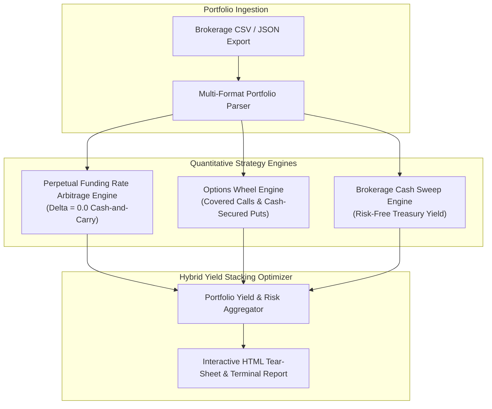

# 🏛️ HedgeMatrix: Institutional Portfolio Hedging & Hybrid Yield Optimizer

<div align="center">

[](https://github.com/hazefund/hedge-matrix)
[](https://www.python.org/)
[]()
[]()
[](https://opensource.org/licenses/MIT)

**An institutional portfolio optimization engine that synthesizes spot equity and digital asset holdings with perpetual funding rate arbitrage, the Options Wheel strategy, and base brokerage cash yields to engineer risk-mitigated, enhanced yield structures.**

[Architecture](#-architecture) • [The 3 Pillars of Yield Stacking](#-the-3-pillars-of-hybrid-yield-stacking) • [Quickstart](#-quickstart) • [Mathematical Formulation](#-mathematical-formulation) • [CLI Reference](#-cli-reference)

</div>

---

## 🏛️ Executive Summary

Conventional portfolio management presents an unwelcome trade-off: **Directional Beta Risk** vs. **Cash Drag**. 

- Holding spot assets leaves portfolios fully exposed to severe market drawdowns.
- Holding cash shields capital from drawdowns, but leaves substantial yield on the table.

**HedgeMatrix** solves this by engineering an active **Yield Stacking Architecture**:
1. **Ingests Portfolio Statements:** Parses CSV or JSON exports from institutional brokerages (Interactive Brokers, Schwab) or cold custody.
2. **Delta-Neutral Basis Hedging:** Detects spot cryptocurrency exposure and evaluates synthetic cash-and-carry hedges against decentralized derivative venues (Hyperliquid, dYdX, Extended) to lock in continuous perpetual funding yields while neutralizing price risk ($\Delta = 0$).
3. **The Options Wheel Overlay:** Evaluates systematic Cash-Secured Puts (CSP) on cash buffers and Covered Calls (CC) on equity positions to harvest volatility decay.
4. **Stacked Brokerage Yield:** Leverages base brokerage cash sweep interest (Treasury yield) simultaneously with option margin collateral, stacking multiple yield layers onto identical capital.

---

## 📐 Architecture



---

## ⚡ The 3 Pillars of Hybrid Yield Stacking

```
┌────────────────────────────────────────────────────────────────────────┐
│                   TOTAL STACKED PORTFOLIO YIELD                        │
├─────────────────────────┬───────────────────────┬──────────────────────┤
│  1. BASE BROKERAGE      │  2. THE OPTIONS WHEEL │  3. PERP FUNDING ARB │
│  Cash Sweep / T-Bills   │  Covered Calls & CSPs │  Cash-and-Carry Basis│
│  4.5% - 5.0% APY        │  12.0% - 20.0% APR    │  15.0% - 30.0% APR   │
│  (Risk-Free Floor)      │  (Theta Decay)        │  (Delta = 0.0 Neutral)│
└─────────────────────────┴───────────────────────┴──────────────────────┘
```

1. **Brokerage Cash Floor:** Base brokerage accounts (e.g., Interactive Brokers) allow cash balances to earn prevailing short-term Treasury rates (~4.8% APY) while simultaneously serving as collateral for option underwriting.
2. **The Options Wheel:**
   - **Cash-Secured Puts (CSP):** Systematically underwrites 30–45 DTE 7% out-of-the-money puts on desired acquisitions, harvesting options premium while acquiring shares at a steep discount if assigned.
   - **Covered Calls (CC):** Underwrites 30–45 DTE calls on spot equities to monetize upside variance and create downside loss buffers.
3. **Perpetual Basis Arbitrage:**
   - Pairs spot assets held in custody with an equivalent short perpetual swap on decentralized derivative venues.
   - Eliminates directional beta ($\text{Net Delta} = 0.0$) while continuously capturing funding premiums paid by perpetual longs to shorts.

---

## 🚀 Quickstart

### 1. Installation

Install directly in editable mode (zero external dependencies required):

```bash
git clone https://github.com/hazefund/hedge-matrix.git
cd hedge-matrix
pip install -e .
```

### 2. Run Instant Demo

Test the engine on an institutional multi-asset sample portfolio (BTC, ETH, SOL, SPY, NVDA, AAPL, Cash):

```bash
hedge-matrix demo
```

To export an interactive HTML tear-sheet:

```bash
hedge-matrix demo --html report.html
```

### 3. Analyze Your Own Portfolio

Export your holdings from your brokerage or ledger to a CSV file (e.g. `portfolio.csv`):

```csv
symbol,type,shares,cost_basis,current_price
BTC,crypto,1.5,58000.00,64500.00
ETH,crypto,12.0,2400.00,2650.00
SPY,equity,100.0,510.00,570.00
USD,cash,50000.00,1.00,1.00
```

Run optimization analysis:

```bash
hedge-matrix analyze portfolio.csv --html my_hedge_plan.html
```

---

## 📊 Sample Terminal Output

```text
╔══════════════════════════════════════════════════════════════════════════════════════════╗
║                 🏛️  HedgeMatrix: Institutional Portfolio Optimization                    ║
╚══════════════════════════════════════════════════════════════════════════════════════════╝

════════════════════════════════════════════════════════════════════════════════════════════
  📊 PORTFOLIO COMPOSITION & ASSET ALLOCATION
════════════════════════════════════════════════════════════════════════════════════════════
  Symbol     Type     Qty          Cost Basis     Price          Market Value     PnL
  ────────────────────────────────────────────────────────────────────────────────────────
  BTC        crypto   1.5000       $58000.00      $64500.00      $96,750.00       +11.2% (+$9,750)
  ETH        crypto   12.0000      $2400.00       $2650.00       $31,800.00       +10.4% (+$3,000)
  SOL        crypto   80.0000      $130.00        $155.00        $12,400.00       +19.2% (+$2,000)
  SPY        equity   100.0000     $510.00        $570.00        $57,000.00       +11.8% (+$6,000)
  NVDA       equity   150.0000     $110.00        $125.00        $18,750.00       +13.6% (+$2,250)
  AAPL       equity   100.0000     $195.00        $228.00        $22,800.00       +16.9% (+$3,300)
  USD CASH   cash     -            -              -              $50,000.00       -
  ────────────────────────────────────────────────────────────────────────────────────────
  Total Portfolio Net Worth: $289,500.00  (Crypto: $140,950.00 | Equities: $98,550.00 | Cash: $50,000.00)

════════════════════════════════════════════════════════════════════════════════════════════
  📈 YIELD ENHANCEMENT & HEDGING STRATEGY MATRIX
════════════════════════════════════════════════════════════════════════════════════════════
  Asset        Strategy                         Proj. Yield    Protection     Annual Income
  ────────────────────────────────────────────────────────────────────────────────────────
  USD / CASH   Cash Yield Stacking: Brokerage   12.8% APY      7% buffer      +$6,400.00/yr
  BTC          BTC Delta-Neutral Basis & Fund   18.0% APY      100% buffer    +$17,415.00/yr
  ETH          ETH Delta-Neutral Basis & Fund   18.0% APY      100% buffer    +$5,724.00/yr
  SOL          SOL Delta-Neutral Basis & Fund   18.0% APY      100% buffer    +$2,232.00/yr
  SPY          SPY Options Wheel (Covered Cal   8.1% APY       1% buffer      +$4,591.92/yr
  NVDA         NVDA Options Wheel (Covered Ca   8.1% APY       1% buffer      +$1,510.50/yr
  AAPL         AAPL Options Wheel (Covered Ca   8.1% APY       1% buffer      +$1,836.77/yr
  ────────────────────────────────────────────────────────────────────────────────────────
  ⚡ Baseline Unhedged Yield:  1.34% / year
  🚀 Optimized Hybrid Yield:   13.72% / year (Spread: +12.38%)
  💰 Projected Annual Income:   $39,710.19 / year
  🛡️ Portfolio Hedged Ratio:   58.9%
```

---

## 🧮 Mathematical Formulation

### 1. Stacked Cash Return ($\text{Yield}_{\text{cash}}$)
When cash collateral simultaneously earns risk-free yield $r_{\text{rf}}$ and backs an out-of-the-money cash-secured put with annualized option premium $\Pi_{\text{put}}$:

$$\text{Yield}_{\text{cash}} = r_{\text{rf}} + \Pi_{\text{put}}$$

### 2. Delta-Neutral Cash-and-Carry Basis Capture
For spot holding $S$ paired with an equivalent 1x short perpetual swap with hourly funding rate $r_h$:

$$\Delta_{\text{net}} = \Delta_{\text{spot}} + \Delta_{\text{perp}} = 1.0 + (-1.0) = 0.0$$

$$\text{APR}_{\text{basis}} = r_h \times 24 \times 365 \times 100$$

### 3. Aggregate Portfolio Yield ($\text{Yield}_{\text{total}}$)
Where $w_i$ represents the portfolio weight of each capital tranche:

$$\text{Yield}_{\text{portfolio}} = \sum_{i} w_i \cdot \text{Yield}_i$$

---

## 🧪 Testing

Run unit tests with `pytest`:

```bash
pytest
```

All 7 core unit tests verify:
- Accurate ingestion and asset classification from CSV and JSON files.
- Delta calculation and zero-beta enforcement on cash-and-carry hedges.
- Options Wheel premium and strike distance approximations.
- Capital-weighted aggregate yield stacking calculations.

---

## ⚖️ Disclaimer

*This software is developed strictly for research, educational, and simulation purposes. It does not constitute investment advice. Options trading and perpetual derivative contracts entail financial risks, including margin calls, liquidation risk, and counterparty platform risk.*

---

<div align="center">
  <sub>Maintained by <b><a href="https://github.com/hazefund">@hazefund</a></b> • Quantitative Architecture & Hybrid Yield Systems</sub>
</div>
